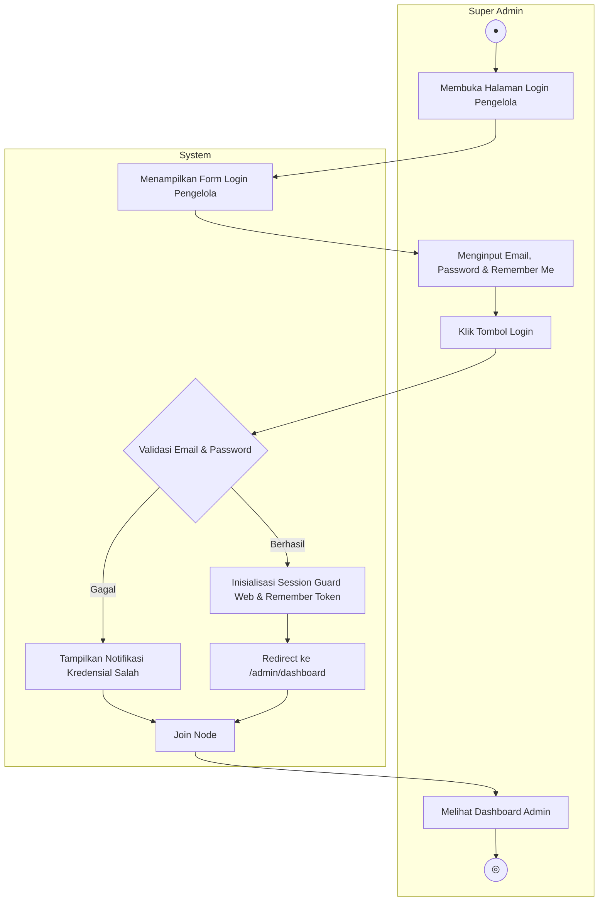
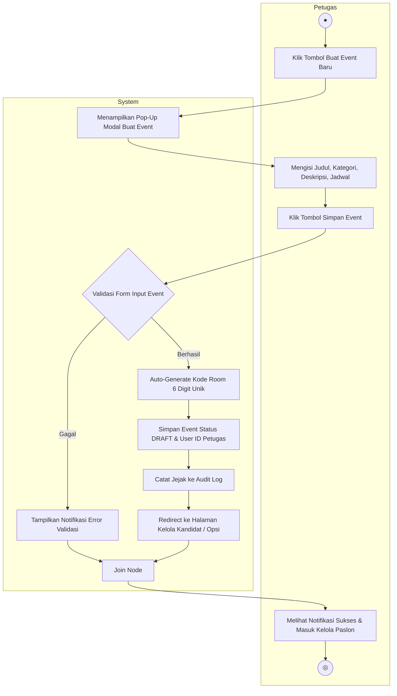
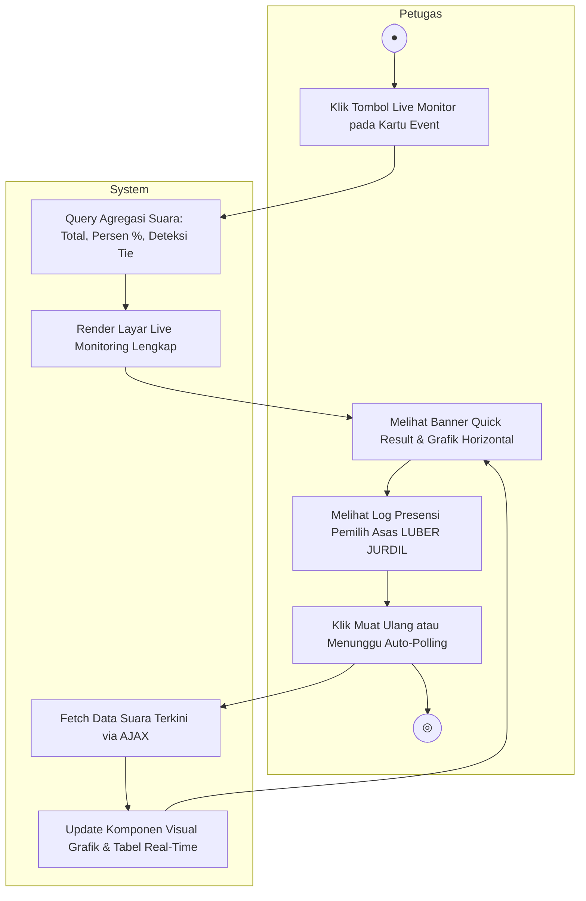
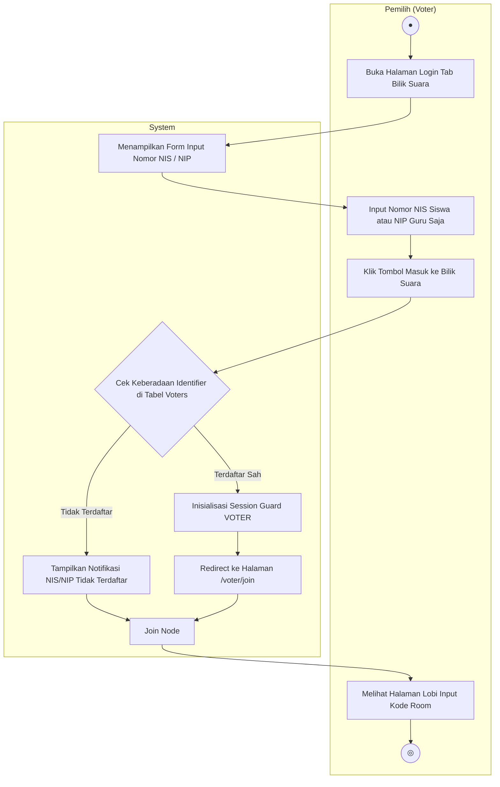
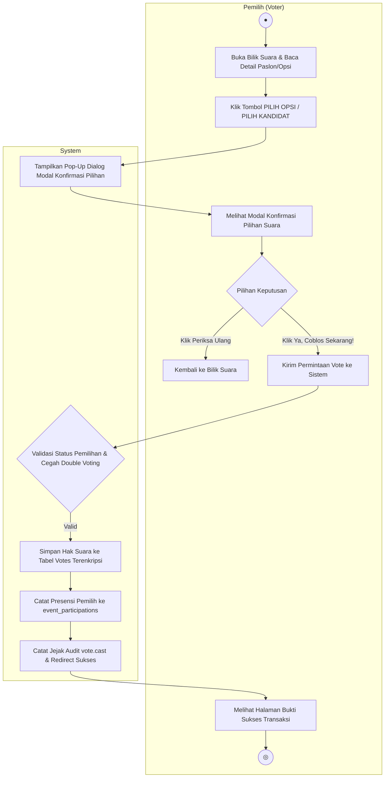

# 4. Activity Diagram - SISTEM E-VOTING "VOTINGYUK"

---

## 4.1 Deskripsi Umum

**Activity Diagram** (Diagram Aktivitas) adalah salah satu jenis diagram perilaku (*behavioral diagram*) dalam standar UML (*Unified Modeling Language*) yang memodelkan **alur kerja sistem (*workflow*) dan rangkaian proses bisnis langkah demi langkah**. Diagram ini menggambarkan urutan aktivitas operasional, titik awal proses (*initial node*), percabangan keputusan (*decision node*), penggabungan (*join node*), hingga titik akhir proses (*activity final node*).

Perbedaan konseptual antara Use Case Diagram dan Activity Diagram:
- **Use Case Diagram** berfokus pada **"APA"** kemampuan dan layanan yang disediakan sistem untuk setiap aktor pengguna.
- **Activity Diagram** berfokus pada **"BAGAIMANA"** logika bisnis dan urutan langkah interaksi dieksekusi secara nyata oleh aktor dan sistem melalui mekanisme partisi **Swimlane**.

Setiap Activity Diagram dalam dokumen ini diturunkan secara presisi dari **12 Layar Antarmuka UI** dan **Use Case Diagram** sistem VOTINGYUK yang telah terverifikasi secara langsung pada kode sumber Laravel 11.

---

## 4.2 Standar Notasi Simbol UML Activity Diagram

Berdasarkan standar representasi visual UML, simbol-simbol yang digunakan dalam diagram aktivitas didefinisikan pada tabel berikut:

| Simbol | Nama Simbol | Keterangan |
| :---: | :---: | :---|
| ● | **Status Awal (*Initial Node*)** | Menandai titik dimulainya suatu aliran aktivitas pada proses. Diagram selalu diawali dengan tepat satu status awal. |
| ( Aktivitas ) | **Aktivitas (*Action State*)** | Tindakan atau pekerjaan yang dilakukan oleh aktor atau sistem. Nama aktivitas diawali dengan **kata kerja aktif** (misal: *Membuka*, *Menampilkan*, *Memvalidasi*, *Menyimpan*). |
| ◇ | **Percabangan (*Decision Node*)** | Titik logika di mana terdapat kondisi bersyarat (*guard condition*) yang menghasilkan lebih dari satu jalur pilihan (misal: *Berhasil* vs *Gagal*). |
| ==================== | **Penggabungan (*Join / Merge Node*)** | Garis horizontal tebal yang menyatukan kembali dua atau lebih aliran cabang aktivitas menjadi satu aliran terpadu berikutnya. |
| (●) | **Status Akhir (*Final State / Activity Final*)** | Menandai titik berakhirnya seluruh rangkaian proses pada diagram aktivitas. |
| ┌──────┬──────┐<br>│ Aktor │ System│<br>└──────┴──────┘ | **Swimlane** | Kolom partisi vertikal yang memisahkan tanggung jawab antara aktor manusia (*Human Actor*) dan perangkat lunak (*System*). |

---

## 4.3 Struktur & Pemetaan Activity Diagram

Sistem **VOTINGYUK** memiliki 3 kelompok besar Activity Diagram berdasarkan hak akses Multi-Guard dan 12 layar antarmuka sistem:

```
┌────────────────────────────────────────────────────────────────────────────────────────┐
│                        DAFTAR ACTIVITY DIAGRAM SISTEM VOTINGYUK                        │
├──────────────────────────┬─────────────────────────────┬───────────────────────────────┤
│    ROLE SUPER ADMIN      │        ROLE PETUGAS         │      ROLE PEMILIH (VOTER)     │
│       (Guard: web)       │        (Guard: web)         │        (Guard: voter)         │
├──────────────────────────┼─────────────────────────────┼───────────────────────────────┤
│ 1. Login Super Admin     │ 10. Login Petugas           │ 19. Login Pemilih (NIS/NIP)   │
│ 2. Melihat Dashboard     │ 11. Melihat Daftar Event    │ 20. Input Kode Room           │
│ 3. Melihat Daftar Akun   │ 12. Tambah Event Pemilihan  │ 21. Bilik Suara Pemilih       │
│ 4. Tambah Pengelola      │ 13. Edit Event              │ 22. Konfirmasi Modal Voting   │
│ 5. Tambah Pemilih (Voter)│ 14. Hapus Event             │ 23. Melihat Halaman Sukses    │
│ 6. Edit Akun User        │ 15. Mengubah Status Event   │ 24. Logout Pemilih            │
│ 7. Hapus Akun User       │ 16. Melihat Kandidat/Opsi   │                               │
│ 8. Melihat Audit Log     │ 17. Tambah Kandidat/Opsi    │                               │
│ 9. Logout Super Admin    │ 18. Live Monitoring Suara   │                               │
└──────────────────────────┴─────────────────────────────┴───────────────────────────────┘
```

---

## 4.4 Kelompok Activity Diagram: Super Admin

Super Admin bertindak sebagai pengelola tertinggi infrastruktur dan pengguna sistem. Berdasarkan prinsip *Separation of Duty*, Super Admin berwenang mengelola seluruh akun (Admin, Petugas, Pemilih) dan memantau rekaman jejak digital (Audit Logs), namun **tidak memiliki akses** membuat event pemilihan atau bilik suara.

---

### 4.4.1 Activity Diagram: Login Super Admin

* **Terkait Layar UI:** Halaman 2 (*Login Pengelola - Tab Petugas & Admin*) $\rightarrow$ Halaman 3 (*Dashboard Super Admin*).
* **Use Case:** `Login Sistem` $\rightarrow$ `Melihat Dashboard Admin`.

```
+-------------------------------------------------------------+
|                      Login Super Admin                      |
+------------------------------+------------------------------+
|         Super Admin          |            System            |
+------------------------------+------------------------------+
|              ●               |                              |
|              │               |                              |
|              ▼               |                              |
|   ( Membuka halaman login    |                              |
|     tab Petugas & Admin )    |                              |
|              │               |                              |
|              └───────────────┼─────────────►( Menampilkan   |
|                              |               form login     |
|   ( Mengisi Email, Password, │               pengelola )    |
|     & centang Remember Me )◄─┼──────────────────────┘       |
|              │               |                              |
|   ( Klik tombol "Login" )    |                              |
|              │               |                              |
|              └───────────────┼─────────────►◇ Validasi Akun |
|                              |                (Email & Pwd) |
|                              |              │               |
|                              |        gagal │ berhasil      |
|                              |  ┌───────────┘    │          |
|                              |  ▼                ▼          |
|                              | ( Tampilkan     ( Buat sesi  |
|                              |   notifikasi      guard web &|
|                              |   kredensial      remember   |
|                              |   salah )         token )    |
|                              |       │               │      |
|                              |       │               ▼      |
|                              |       │         ( Redirect   |
|                              |       │           ke /admin/ |
|                              |       │           dashboard )|
|                              |       │               │      |
|                              |       └───────┬───────┘      |
|                              |               ▼              |
|                              |     ====================     |
|   ( Menerima respon sistem & │               │              |
|     melihat dashboard admin )◄───────────────┘              |
|              │               |                              |
|              ▼               |                              |
|             (●)              |                              |
+------------------------------+------------------------------+
```



---

### 4.4.2 Activity Diagram: Melihat Dashboard Admin

* **Terkait Layar UI:** Halaman 3 (*Super Admin - Beranda Dashboard*).
* **Use Case:** `Melihat Dashboard Admin`.

```
+-------------------------------------------------------------+
|                   Melihat Dashboard Admin                   |
+------------------------------+------------------------------+
|         Super Admin          |            System            |
+------------------------------+------------------------------+
|              ●               |                              |
|              │               |                              |
|              ▼               |                              |
|   ( Mengakses menu Beranda   |                              |
|     pada sidebar navigasi )  |                              |
|              │               |                              |
|              └───────────────┼─────────────►( Verifikasi    |
|                              |               sesi role      |
|                              |               SUPER ADMIN )  |
|                              |                      │       |
|                              |                      ▼       |
|                              |              ( Query agregasi|
|                              |                4 metric card,|
|                              |                info server, &|
|                              |                6 log audit ) |
|                              |                      │       |
|                              |                      ▼       |
|   ( Melihat 4 metric cards,  │              ( Render halaman|
|     spesifikasi server, dan  │                dashboard     |
|     tabel audit log terkini )◄────────────────beranda )     |
|              │               |                              |
|              ▼               |                              |
|             (●)              |                              |
+------------------------------+------------------------------+
```

---

### 4.4.3 Activity Diagram: Melihat Daftar Akun (3 Tab)

* **Terkait Layar UI:** Halaman 4 (*Super Admin - Kelola Akun: Tab Super Admin, Petugas, Pemilih*).
* **Use Case:** `Melihat Daftar Akun`.

```
+-------------------------------------------------------------+
|                     Melihat Daftar Akun                     |
+------------------------------+------------------------------+
|         Super Admin          |            System            |
+------------------------------+------------------------------+
|              ●               |                              |
|              │               |                              |
|              ▼               |                              |
|   ( Mengklik menu            |                              |
|     "Kelola Akun" )          |                              |
|              │               |                              |
|              └───────────────┼─────────────►( Menampilkan   |
|                              |               halaman kelola |
|   ( Memilih salah satu tab:  │               akun default ) |
|     Super Admin / Petugas /  │                      │       |
|     Pemilih Siswa & Guru )◄──┼──────────────────────┘       |
|              │               |                              |
|              └───────────────┼─────────────►◇ Pilihan Tab   |
|                              |                yang Dipilih  |
|                              |              │               |
|                              |   ┌──────────┼──────────┐    |
|                              |   ▼          ▼          ▼    |
|                              | [Tab Admin][Tab Petugas][Tab |
|                              |   │          │        Voter] |
|                              | (Query User(Query User(Query |
|                              |  role Admin)role Petugas)Voter)|
|                              |   │          │          │    |
|                              |   └──────────┼──────────┘    |
|                              |              ▼               |
|   ( Melihat tabel daftar     │      ( Render tabel data     |
|     pengguna sesuai tab &    │        pengguna, badge role, |
|     tombol aksi kelola )◄────┼────────dan tombol aksi )     |
|              │               |                              |
|              ▼               |                              |
|             (●)              |                              |
+------------------------------+------------------------------+
```

---

### 4.4.4 Activity Diagram: Tambah Akun Pengelola (Super Admin & Petugas)

* **Terkait Layar UI:** Halaman 4 (*Tombol Merah "+ Tambah Super Admin" dan "+ Tambah Petugas"*).
* **Use Case:** `Tambah Akun Pengguna` (`<<extend>>` ke `Melihat Daftar Akun`).

```
+-------------------------------------------------------------+
|            Tambah Akun Pengelola (Admin/Petugas)            |
+------------------------------+------------------------------+
|         Super Admin          |            System            |
+------------------------------+------------------------------+
|              ●               |                              |
|              │               |                              |
|              ▼               |                              |
|   ( Berada di Tab Admin /    |                              |
|     Tab Petugas & klik       |                              |
|     "+ Tambah [Role]" )      |                              |
|              │               |                              |
|              └───────────────┼─────────────►( Menampilkan   |
|                              |               pop-up modal   |
|   ( Mengisi formulir:        │               form tambah    |
|     - Nama Lengkap           │               pengelola )    |
|     - Email                  │                      │       |
|     - Password (min 6 kar)   │                      │       |
|     - Konfirmasi Password )◄─┼──────────────────────┘       |
|              │               |                              |
|   ( Klik tombol "Simpan" )   |                              |
|              │               |                              |
|              └───────────────┼─────────────►◇ Validasi Form |
|                              |                Pengelola     |
|                              |              │               |
|                              |        gagal │ berhasil      |
|                              |  ┌───────────┘    │          |
|                              |  ▼                ▼          |
|                              | ( Tampilkan     ( Hash bcrypt|
|                              |   notifikasi      password,  |
|                              |   error email     simpan ke  |
|                              |   duplikat /      tabel      |
|                              |   password        users,     |
|                              |   tidak cocok )   catat log, |
|                              |       │           tutup modal│
|                              |       │               │      |
|                              |       └───────┬───────┘      |
|                              |               ▼              |
|                              |     ====================     |
|   ( Menerima notifikasi      │               │              |
|     sukses & melihat admin / │               │              |
|     petugas baru di tabel )◄─┼───────────────┘              |
|              │               |                              |
|              ▼               |                              |
|             (●)              |                              |
+------------------------------+------------------------------+
```

---

### 4.4.5 Activity Diagram: Tambah Akun Pemilih (Siswa & Guru)

* **Terkait Layar UI:** Halaman 4 (*Tab Pemilih - Tombol Merah "+ Tambah Pemilih"*).
* **Use Case:** `Tambah Akun Pengguna` (`<<extend>>` ke `Melihat Daftar Akun`).

```
+-------------------------------------------------------------+
|              Tambah Akun Pemilih (Siswa/Guru)               |
+------------------------------+------------------------------+
|         Super Admin          |            System            |
+------------------------------+------------------------------+
|              ●               |                              |
|              │               |                              |
|              ▼               |                              |
|   ( Berada di Tab Pemilih    |                              |
|     & klik tombol merah      |                              |
|     "+ Tambah Pemilih" )     |                              |
|              │               |                              |
|              └───────────────┼─────────────►( Menampilkan   |
|                              |               pop-up modal   |
|   ( Mengisi formulir voter:  │               form tambah    |
|     - NIS [Siswa] / NIP [Guru│               pemilih )      |
|     - Nama Lengkap           │                      │       |
|     - Tipe (Siswa / Guru)    │                      │       |
|     * TANPA INPUT PASSWORD )◄┼──────────────────────┘       |
|              │               |                              |
|   ( Klik tombol "Simpan" )   |                              |
|              │               |                              |
|              └───────────────┼─────────────►◇ Validasi Form |
|                              |                Voter         |
|                              |              │               |
|                              |        gagal │ berhasil      |
|                              |  ┌───────────┘    │          |
|                              |  ▼                ▼          |
|                              | ( Tampilkan     ( Simpan ke  |
|                              |   error NIS/NIP   tabel      |
|                              |   duplikat atau   voters     |
|                              |   format salah)   [tanpa     |
|                              |       │           password], |
|                              |       │           catat log, |
|                              |       │           tutup modal│
|                              |       │               │      |
|                              |       └───────┬───────┘      |
|                              |               ▼              |
|                              |     ====================     |
|   ( Menerima notifikasi      │               │              |
|     sukses & melihat pemilih │               │              |
|     baru masuk tabel DPT )◄──┼───────────────┘              |
|              │               |                              |
|              ▼               |                              |
|             (●)              |                              |
+------------------------------+------------------------------+
```

---

### 4.4.6 Activity Diagram: Edit Akun User

* **Terkait Layar UI:** Halaman 4 (*Tombol Aksi "Edit" pada Baris Data Pengguna*).
* **Use Case:** `Edit Akun Pengguna` (`<<extend>>` ke `Melihat Daftar Akun`).

```
+-------------------------------------------------------------+
|                       Edit Akun User                        |
+------------------------------+------------------------------+
|         Super Admin          |            System            |
+------------------------------+------------------------------+
|              ●               |                              |
|              │               |                              |
|              ▼               |                              |
|   ( Klik tombol "Edit"       |                              |
|     pada baris pengguna )    |                              |
|              │               |                              |
|              └───────────────┼─────────────►( Mengambil data|
|                              |               dan tampilkan  |
|   ( Mengubah nama, email,    │               modal edit )   |
|     atau reset password )◄───┼──────────────────────┘       |
|              │               |                              |
|   ( Klik tombol "Perbarui" ) |                              |
|              │               |                              |
|              └───────────────┼─────────────►◇ Validasi Data |
|                              |                Form Edit     |
|                              |              │               |
|                              |        gagal │ berhasil      |
|                              |  ┌───────────┘    │          |
|                              |  ▼                ▼          |
|                              | ( Tampilkan     ( Update ke  |
|                              |   notifikasi      database,  |
|                              |   error input )   catat log, |
|                              |       │           tutup modal│
|                              |       │               │      |
|                              |       └───────┬───────┘      |
|                              |               ▼              |
|                              |     ====================     |
|   ( Menerima notifikasi      │               │              |
|     sukses & melihat         │               │              |
|     pembaruan di tabel )◄────┼───────────────┘              |
|              │               |                              |
|              ▼               |                              |
|             (●)              |                              |
+------------------------------+------------------------------+
```

---

### 4.4.7 Activity Diagram: Hapus Akun User

* **Terkait Layar UI:** Halaman 4 (*Tombol Aksi "Hapus" pada Baris Data Pengguna*).
* **Use Case:** `Hapus Akun Pengguna` (`<<extend>>` ke `Melihat Daftar Akun`).

```
+-------------------------------------------------------------+
|                       Hapus Akun User                       |
+------------------------------+------------------------------+
|         Super Admin          |            System            |
+------------------------------+------------------------------+
|              ●               |                              |
|              │               |                              |
|              ▼               |                              |
|   ( Klik tombol "Hapus"      |                              |
|     pada baris pengguna )    |                              |
|              │               |                              |
|              └───────────────┼─────────────►( Menampilkan   |
|                              |               dialog         |
|   ( Memilih keputusan:       │               konfirmasi     |
|     Batal atau Hapus )◄──────┼───────────────"Yakin Hapus?")|
|              │               |                      │       |
|              └───────────────┼─────────────►◇ Pilihan       |
|                              |                Konfirmasi    |
|                              |              │               |
|                              |        batal │ yakin hapus   |
|                              |  ┌───────────┘    │          |
|                              |  ▼                ▼          |
|                              | ( Tutup dialog  ◇ Cek ID     |
|                              |   tanpa aksi )    (Bukan diri|
|                              |       │            sendiri?) |
|                              |       │            │         |
|                              |       │      sama  │ beda    |
|                              |       │  ┌─────────┘   │     |
|                              |       │  ▼             ▼     |
|                              |       │ (Tolak:      (Hapus  |
|                              |       │  Hapus Diri   record,|
|                              |       │  Ditolak)     catat  |
|                              |       │    │          audit) |
|                              |       └────┼───────────┘     |
|                              |            ▼                 |
|                              |  ====================        |
|   ( Menerima respon status & │            │                 |
|     melihat pembaruan tabel )◄────────────┘                 |
|              │               |                              |
|              ▼               |                              |
|             (●)              |                              |
+------------------------------+------------------------------+
```

---

### 4.4.8 Activity Diagram: Melihat & Filter Audit Log

* **Terkait Layar UI:** Halaman 5 (*Super Admin - Audit Log & Jejak Digital*).
* **Use Case:** `Melihat Audit Log`.

```
+-------------------------------------------------------------+
|                 Melihat & Filter Audit Log                  |
+------------------------------+------------------------------+
|         Super Admin          |            System            |
+------------------------------+------------------------------+
|              ●               |                              |
|              │               |                              |
|              ▼               |                              |
|   ( Klik menu "Audit Log"    |                              |
|     pada sidebar navigasi )  |                              |
|              │               |                              |
|              └───────────────┼─────────────►( Menampilkan   |
|                              |               halaman audit  |
|   ( Memasukkan keyword &     │               log 20 data )  |
|     memilih dropdown role )◄─┼──────────────────────┘       |
|              │               |                              |
|   ( Klik tombol "Cari &      |                              |
|     Filter" )                |                              |
|              │               |                              |
|              └───────────────┼─────────────►( Eksekusi query|
|                              |               filter log &   |
|                              |               render ulang   |
|   ( Membaca riwayat jejak    │               tabel data )   |
|     digital lengkap dengan   │                      │       |
|     waktu, role, dan aksi )◄─┼──────────────────────┘       |
|              │               |                              |
|              ▼               |                              |
|             (●)              |                              |
+------------------------------+------------------------------+
```

---

### 4.4.9 Activity Diagram: Logout Super Admin

* **Terkait Layar UI:** Header / Sidebar Pengelola.
* **Use Case:** `Logout`.

```
+-------------------------------------------------------------+
|                      Logout Super Admin                     |
+------------------------------+------------------------------+
|         Super Admin          |            System            |
+------------------------------+------------------------------+
|              ●               |                              |
|              │               |                              |
|              ▼               |                              |
|   ( Klik tombol "Logout" )   |                              |
|              │               |                              |
|              └───────────────┼─────────────►( Invalidate    |
|                              |               sesi guard web,|
|                              |               hapus token    |
|                              |               remember me )  |
|                              |                      │       |
|                              |                      ▼       |
|                              |              ( Redirect ke   |
|   ( Kembali ke halaman       │                halaman login |
|     login pengelola )◄───────┼────────────────pengelola )   |
|              │               |                              |
|              ▼               |                              |
|             (●)              |                              |
+------------------------------+------------------------------+
```

---

## 4.5 Kelompok Activity Diagram: Petugas

Petugas adalah panitia pemilihan yang berwenang membuat dan mengelola event pemilihan (*CRUD Event*), mengelola kandidat atau opsi pilihan (*CRUD Candidates/Options*), mengatur siklus status event (*Draft, Published, Closed*), serta memantau perolehan suara secara langsung (*Live Monitoring*). Petugas hanya memiliki otoritas terhadap event yang dibuat oleh dirinya sendiri (`created_by == Auth::id()`).

---

### 4.5.1 Activity Diagram: Login Petugas

* **Terkait Layar UI:** Halaman 2 (*Login Pengelola - Tab Petugas & Admin*) $\rightarrow$ Halaman 6 (*Kelola Event Petugas*).
* **Use Case:** `Login Sistem` (Petugas) $\rightarrow$ `Melihat Daftar Event`.

```
+-------------------------------------------------------------+
|                        Login Petugas                        |
+------------------------------+------------------------------+
|           Petugas            |            System            |
+------------------------------+------------------------------+
|              ●               |                              |
|              │               |                              |
|              ▼               |                              |
|   ( Membuka halaman login    |                              |
|     tab Petugas & Admin )    |                              |
|              │               |                              |
|              └───────────────┼─────────────►( Menampilkan   |
|                              |               form login     |
|   ( Mengisi Email, Password, │               pengelola )    |
|     & klik tombol "Login" )◄─┼──────────────────────┘       |
|              │               |                              |
|              └───────────────┼─────────────►◇ Validasi Akun |
|                              |                Petugas       |
|                              |              │               |
|                              |        gagal │ berhasil      |
|                              |  ┌───────────┘    │          |
|                              |  ▼                ▼          |
|                              | ( Tampilkan     ( Buat sesi  |
|                              |   notifikasi      guard web &|
|                              |   kredensial      set role   |
|                              |   salah )         PETUGAS )  |
|                              |       │               │      |
|                              |       │               ▼      |
|                              |       │         ( Redirect   |
|                              |       │           langsung ke|
|                              |       │           /petugas/  |
|                              |       │           events )   |
|                              |       │               │      |
|                              |       └───────┬───────┘      |
|                              |               ▼              |
|                              |     ====================     |
|   ( Melihat beranda kelola   │               │              |
|     event & banner sambutan )◄───────────────┘              |
|              │               |                              |
|              ▼               |                              |
|             (●)              |                              |
+------------------------------+------------------------------+
```

---

### 4.5.2 Activity Diagram: Melihat Daftar Event (Beranda Petugas)

* **Terkait Layar UI:** Halaman 6 (*Petugas - Kelola Event & Voting*).
* **Use Case:** `Melihat Daftar Event`.

```
+-------------------------------------------------------------+
|                     Melihat Daftar Event                    |
+------------------------------+------------------------------+
|           Petugas            |            System            |
+------------------------------+------------------------------+
|              ●               |                              |
|              │               |                              |
|              ▼               |                              |
|   ( Mengakses menu           |                              |
|     "Kelola Event" )         |                              |
|              │               |                              |
|              └───────────────┼─────────────►( Query event:  |
|                              |               WHERE          |
|                              |               created_by =   |
|                              |               Auth::id() )   |
|                              |                      │       |
|                              |                      ▼       |
|                              |              ( Hitung jumlah |
|                              |                pilihan, suara|
|                              |                masuk, & DPT )|
|                              |                      │       |
|                              |                      ▼       |
|   ( Melihat grid kartu event,│              ( Render grid   |
|     kode room unik, badge    │                kartu event   |
|     status, & tombol aksi )◄─┼────────────────lengkap )     |
|              │               |                              |
|              ▼               |                              |
|             (●)              |                              |
+------------------------------+------------------------------+
```

---

### 4.5.3 Activity Diagram: Tambah Event Baru

* **Terkait Layar UI:** Halaman 6 (*Tombol Biru "Buat Event Baru"*).
* **Use Case:** `Tambah Event Pemilihan` (`<<extend>>` ke `Melihat Daftar Event`).

```
+-------------------------------------------------------------+
|                      Tambah Event Baru                      |
+------------------------------+------------------------------+
|           Petugas            |            System            |
+------------------------------+------------------------------+
|              ●               |                              |
|              │               |                              |
|              ▼               |                              |
|   ( Klik tombol biru         |                              |
|     "Buat Event Baru" )      |                              |
|              │               |                              |
|              └───────────────┼─────────────►( Menampilkan   |
|                              |               pop-up modal   |
|   ( Mengisi judul, deskripsi,│               buat event )   |
|     kategori KANDIDAT/OPSI,  │                      │       |
|     & jadwal waktu )◄────────┼──────────────────────┘       |
|              │               |                              |
|   ( Klik tombol              |                              |
|     "Simpan Event" )         |                              |
|              │               |                              |
|              └───────────────┼─────────────►◇ Validasi Form |
|                              |                (Judul/Kateg) |
|                              |              │               |
|                              |        gagal │ berhasil      |
|                              |  ┌───────────┘    │          |
|                              |  ▼                ▼          |
|                              | ( Tampilkan     ( Generate   |
|                              |   notifikasi      Kode Room  |
|                              |   validasi form   6 digit,   |
|                              |   gagal )         set status |
|                              |       │           DRAFT,     |
|                              |       │           simpan DB, |
|                              |       │           catat log) |
|                              |       │               │      |
|                              |       │               ▼      |
|                              |       │         ( Redirect ke|
|                              |       │           kelola     |
|                              |       │           kandidat ) |
|                              |       │               │      |
|                              |       └───────┬───────┘      |
|                              |               ▼              |
|                              |     ====================     |
|   ( Menerima konfirmasi &    │               │              |
|     lanjut ke halaman        │               │              |
|     tambah kandidat/opsi )◄──┼───────────────┘              |
|              │               |                              |
|              ▼               |                              |
|             (●)              |                              |
+------------------------------+------------------------------+
```



---

### 4.5.4 Activity Diagram: Edit Event

* **Terkait Layar UI:** Halaman 6 (*Icon Pensil "Edit" pada Kartu Event*).
* **Use Case:** `Edit Event Pemilihan` (`<<extend>>` ke `Melihat Daftar Event`).

```
+-------------------------------------------------------------+
|                         Edit Event                          |
+------------------------------+------------------------------+
|           Petugas            |            System            |
+------------------------------+------------------------------+
|              ●               |                              |
|              │               |                              |
|              ▼               |                              |
|   ( Klik icon pensil         |                              |
|     pada kartu event )       |                              |
|              │               |                              |
|              └───────────────┼─────────────►( Validasi akses|
|                              |               & tampilkan    |
|   ( Memperbarui judul,       │               modal edit )   |
|     deskripsi, atau jadwal )◄┼──────────────────────┘       |
|              │               |                              |
|   ( Klik tombol              |                              |
|     "Perbarui Event" )       |                              |
|              │               |                              |
|              └───────────────┼─────────────►◇ Validasi Form |
|                              |                Edit Event    |
|                              |              │               |
|                              |        gagal │ berhasil      |
|                              |  ┌───────────┘    │          |
|                              |  ▼                ▼          |
|                              | ( Tampilkan     ( Update ke  |
|                              |   pesan error     database,  |
|                              |   validasi )      catat log, |
|                              |       │           tutup modal│
|                              |       │               │      |
|                              |       └───────┬───────┘      |
|                              |               ▼              |
|                              |     ====================     |
|   ( Menerima notifikasi      │               │              |
|     sukses & melihat         │               │              |
|     perubahan kartu event )◄─┼───────────────┘              |
|              │               |                              |
|              ▼               |                              |
|             (●)              |                              |
+------------------------------+------------------------------+
```

---

### 4.5.5 Activity Diagram: Hapus Event

* **Terkait Layar UI:** Halaman 6 (*Icon Sampah "Hapus" pada Kartu Event*).
* **Use Case:** `Hapus Event Pemilihan` (`<<extend>>` ke `Melihat Daftar Event`).

```
+-------------------------------------------------------------+
|                         Hapus Event                         |
+------------------------------+------------------------------+
|           Petugas            |            System            |
+------------------------------+------------------------------+
|              ●               |                              |
|              │               |                              |
|              ▼               |                              |
|   ( Klik icon tempat sampah  |                              |
|     pada kartu event )       |                              |
|              │               |                              |
|              └───────────────┼─────────────►( Menampilkan   |
|                              |               dialog         |
|   ( Mengambil keputusan:     │               konfirmasi     |
|     Batal atau Ya, Hapus )◄──┼───────────────"Hapus Event?")|
|              │               |                      │       |
|              └───────────────┼─────────────►◇ Keputusan     |
|                              |                Konfirmasi    |
|                              |              │               |
|                              |        batal │ ya, hapus     |
|                              |  ┌───────────┘    │          |
|                              |  ▼                ▼          |
|                              | ( Tutup dialog  ( Hapus data |
|                              |   tanpa aksi )    event &    |
|                              |       │           kandidat   |
|                              |       │           cascade,   |
|                              |       │           catat log) |
|                              |       │               │      |
|                              |       └───────┬───────┘      |
|                              |               ▼              |
|                              |     ====================     |
|   ( Menerima notifikasi      │               │              |
|     sukses & melihat         │               │              |
|     kartu event terhapus )◄──┼───────────────┘              |
|              │               |                              |
|              ▼               |                              |
|             (●)              |                              |
+------------------------------+------------------------------+
```

---

### 4.5.6 Activity Diagram: Mengubah Status Event (Publish / Tutup Event)

* **Terkait Layar UI:** Halaman 6 (*Tombol Merah "TUTUP EVENT" atau Tombol "PUBLISH EVENT"*).
* **Use Case:** `Mengubah Status Event` (`<<extend>>` ke `Melihat Daftar Event`).

```
+-------------------------------------------------------------+
|                    Mengubah Status Event                    |
+------------------------------+------------------------------+
|           Petugas            |            System            |
+------------------------------+------------------------------+
|              ●               |                              |
|              │               |                              |
|              ▼               |                              |
|   ( Klik tombol aksi status: |                              |
|     "PUBLISH" / "TUTUP" )    |                              |
|              │               |                              |
|              └───────────────┼─────────────►◇ Jenis Aksi    |
|                              |                yang Dipilih  |
|                              |              │               |
|                              |    [Publish] │ [Tutup Event] |
|                              |  ┌───────────┘       │       |
|                              |  ▼                   ▼       |
|                              | ◇ Cek Total    ( Set status  |
|                              |   Pilihan        CLOSED /    |
|                              |   (Count>=2?)    Selesai,    |
|                              |   │              catat log)  |
|                              |   ├──<2: Tolak       │       |
|                              |   │      Tampilkan   │       |
|                              |   │      Error       │       |
|                              |   │      Min 2       │       |
|                              |   └──>=2: Set        │       |
|                              |           Status     │       |
|                              |           PUBLISHED, │       |
|                              |           catat log  │       |
|                              |           │          │       |
|                              |           └────┬─────┘       |
|                              |                ▼             |
|                              |      ====================    |
|   ( Melihat perubahan badge  │                │             |
|     status aktif / selesai )◄┼────────────────┘             |
|              │               |                              |
|              ▼               |                              |
|             (●)              |                              |
+------------------------------+------------------------------+
```

---

### 4.5.7 Activity Diagram: Melihat Daftar Kandidat / Opsi

* **Terkait Layar UI:** Halaman 7 (*Petugas - Kelola Kandidat / Kelola Opsi*).
* **Use Case:** `Melihat Daftar Kandidat/Opsi` (`<<extend>>` ke `Melihat Daftar Event`).

```
+-------------------------------------------------------------+
|                Melihat Daftar Kandidat / Opsi               |
+------------------------------+------------------------------+
|           Petugas            |            System            |
+------------------------------+------------------------------+
|              ●               |                              |
|              │               |                              |
|              ▼               |                              |
|   ( Klik tombol              |                              |
|     "Kandidat" / "Opsi" pada |                              |
|     kartu event )            |                              |
|              │               |                              |
|              └───────────────┼─────────────►( Validasi event|
|                              |               milik petugas  |
|                              |               terautentikasi)|
|                              |                      │       |
|                              |                      ▼       |
|                              |              ( Query kandidat|
|                              |                ORDER BY      |
|                              |                nomor urut    |
|                              |                ASC )         |
|                              |                      │       |
|                              |                      ▼       |
|   ( Melihat kartu kandidat:  │              ( Render halaman|
|     nomor, foto, nama, visi- │                kelola        |
|     misi/deskripsi, & tombol)◄────────────────kandidat )    |
|              │               |                              |
|              ▼               |                              |
|             (●)              |                              |
+------------------------------+------------------------------+
```

---

### 4.5.8 Activity Diagram: Tambah Kandidat / Opsi

* **Terkait Layar UI:** Halaman 7 (*Tombol Biru "Tambah Kandidat Baru" / "Tambah Opsi Baru"*).
* **Use Case:** `Tambah Kandidat/Opsi` (`<<extend>>` ke `Melihat Daftar Kandidat/Opsi`).

```
+-------------------------------------------------------------+
|                    Tambah Kandidat / Opsi                   |
+------------------------------+------------------------------+
|           Petugas            |            System            |
+------------------------------+------------------------------+
|              ●               |                              |
|              │               |                              |
|              ▼               |                              |
|   ( Klik tombol biru         |                              |
|     "+ Tambah Baru" )        |                              |
|              │               |                              |
|              └───────────────┼─────────────►( Menampilkan   |
|                              |               pop-up modal   |
|   ( Mengisi nomor urut, nama,│               form input )   |
|     visi-misi/deskripsi, &   │                      │       |
|     upload foto maks 2MB )◄──┼──────────────────────┘       |
|              │               |                              |
|   ( Klik tombol "Simpan" )   |                              |
|              │               |                              |
|              └───────────────┼─────────────►◇ Validasi Input|
|                              |                (Unik & File) |
|                              |              │               |
|                              |        gagal │ berhasil      |
|                              |  ┌───────────┘    │          |
|                              |  ▼                ▼          |
|                              | ( Tampilkan     ( Upload foto|
|                              |   pesan error     ke storage,|
|                              |   validasi form   simpan DB, |
|                              |   di modal )      catat log, |
|                              |       │           tutup modal│
|                              |       │               │      |
|                              |       └───────┬───────┘      |
|                              |               ▼              |
|                              |     ====================     |
|   ( Menerima konfirmasi      │               │              |
|     sukses & melihat kartu   │               │              |
|     pilihan baru muncul )◄───┼───────────────┘              |
|              │               |                              |
|              ▼               |                              |
|             (●)              |                              |
+------------------------------+------------------------------+
```

---

### 4.5.9 Activity Diagram: Live Monitoring Suara Real-Time

* **Terkait Layar UI:** Halaman 8 (*Petugas - Live Monitoring Suara*).
* **Use Case:** `Melihat Live Monitoring` (`<<extend>>` ke `Melihat Daftar Event`).

```
+-------------------------------------------------------------+
|                    Live Monitoring Suara                    |
+------------------------------+------------------------------+
|           Petugas            |            System            |
+------------------------------+------------------------------+
|              ●               |                              |
|              │               |                              |
|              ▼               |                              |
|   ( Klik tombol              |                              |
|     "Live Monitor" pada      |                              |
|     kartu event )            |                              |
|              │               |                              |
|              └───────────────┼─────────────►( Hitung suara: |
|                              |               total, persen, |
|                              |               deteksi tie /  |
|                              |               pemenang )     |
|                              |                      │       |
|                              |                      ▼       |
|                              |              ( Ambil log     |
|                              |                presensi asas |
|                              |                LUBER JURDIL )|
|                              |                      │       |
|                              |                      ▼       |
|   ( Memantau banner quick    │              ( Render layar  |
|     result, grafik suara,    │                monitoring &  |
|     & tabel log presensi )◄──┼────────────────jalankan timer|
|              │               |                auto-refresh )|
|              ▼               |                      │       |
|   ( Klik tombol Muat Ulang / │                      ▼       |
|     menunggu auto-polling )──┼─────────────►( Query data    |
|              │               |                suara terbaru |
|              │               |                & update UI ) |
|              │               |                      │       |
|              ▼               |                      │       |
|             (●)              |                      │       |
|                              |                      ▼       |
|                              |              ( Terus update  |
|                              |                selama buka ) |
+------------------------------+------------------------------+
```



---

## 4.6 Kelompok Activity Diagram: Pemilih (Voter)

Pemilih (Siswa dan Guru) menggunakan aplikasi melalui guard `voter`. Pemilih memiliki alur yang sangat ramping, aman, dan mudah dipahami: melakukan login hanya dengan memasukkan NIS/NIP (tanpa password), memasukkan kode room di lobi, memilih paslon di bilik suara tertutup, mengonfirmasi pilihan melalui pop-up modal, dan menerima tanda bukti transaksi voting di halaman sukses.

---

### 4.6.1 Activity Diagram: Login Pemilih (HANYA NIS / NIP)

* **Terkait Layar UI:** Halaman 1 (*Login Pemilih - Tab Bilik Suara*).
* **Use Case:** `Login Sistem` (Pemilih / Voter) $\rightarrow$ `Input Kode Room`.

```
+-------------------------------------------------------------+
|                        Login Pemilih                        |
+------------------------------+------------------------------+
|       Pemilih (Voter)        |            System            |
+------------------------------+------------------------------+
|              ●               |                              |
|              │               |                              |
|              ▼               |                              |
|   ( Membuka halaman login    |                              |
|     tab Bilik Suara )        |                              |
|              │               |                              |
|              └───────────────┼─────────────►( Menampilkan   |
|                              |               form input NIS |
|   ( Menginput NIS / NIP saja │               / NIP tunggal )|
|     TANPA field password )◄──┼──────────────────────┘       |
|              │               |                              |
|   ( Klik tombol merah        |                              |
|     "Masuk ke Bilik Suara" ) |                              |
|              │               |                              |
|              └───────────────┼─────────────►◇ Cek NIS/NIP   |
|                              |                di Tabel Voter|
|                              |              │               |
|                              |    tidak ada │ terdaftar     |
|                              |  ┌───────────┘    │          |
|                              |  ▼                ▼          |
|                              | ( Tampilkan     ( Buat sesi  |
|                              |   pesan NIS/NIP   guard voter|
|                              |   tidak           & catat ID |
|                              |   terdaftar )     pemilih )  |
|                              |       │               │      |
|                              |       │               ▼      |
|                              |       │         ( Redirect ke|
|                              |       │           halaman    |
|                              |       │           lobi join )|
|                              |       │               │      |
|                              |       └───────┬───────┘      |
|                              |               ▼              |
|                              |     ====================     |
|   ( Tiba di lobi join &      │               │              |
|     melihat nama sendiri )◄──┼───────────────┘              |
|              │               |                              |
|              ▼               |                              |
|             (●)              |                              |
+------------------------------+------------------------------+
```



---

### 4.6.2 Activity Diagram: Input Kode Room

* **Terkait Layar UI:** Halaman 9 (*Pemilih - Input Kode Room Lobi*).
* **Use Case:** `Input Kode Room` $\xrightarrow{\text{<<include>>}}$ `Login Sistem`.

```
+-------------------------------------------------------------+
|                       Input Kode Room                       |
+------------------------------+------------------------------+
|       Pemilih (Voter)        |            System            |
+------------------------------+------------------------------+
|              ●               |                              |
|              │               |                              |
|              ▼               |                              |
|   ( Berada di halaman lobi,  |                              |
|     memeriksa identitas )    |                              |
|              │               |                              |
|   ( Mengetikkan 6 digit kode |                              |
|     room, misal: TOUR45 )    |                              |
|              │               |                              |
|   ( Klik tombol              |                              |
|     "Masuk Bilik Suara" )    |                              |
|              │               |                              |
|              └───────────────┼─────────────►◇ Validasi Room |
|                              |                Code & Status |
|                              |              │               |
|                              |  tidak aktif │ aktif         |
|                              |  ┌───────────┘    │          |
|                              |  ▼                ▼          |
|                              | ( Tampilkan     ◇ Cek Sudah  |
|                              |   error kode      Memilih?   |
|                              |   tidak aktif     (Presensi) |
|                              |   / ditutup )     │          |
|                              |       │     sudah │ belum    |
|                              |       │  ┌────────┘   │      |
|                              |       │  ▼            ▼      |
|                              |       │ (Tolak:     (Izinkan |
|                              |       │  Sudah Beri  akses & |
|                              |       │  Suara)      redirect|
|                              |       │    │         bilik)  |
|                              |       └────┼──────────┘      |
|                              |            ▼                 |
|                              |  ====================        |
|   ( Masuk ke bilik suara     │            │                 |
|     atau membaca peringatan )◄────────────┘                 |
|              │               |                              |
|              ▼               |                              |
|             (●)              |                              |
+------------------------------+------------------------------+
```

---

### 4.6.3 Activity Diagram: Melakukan Voting di Bilik Suara

* **Terkait Layar UI:** Halaman 10 (*Pemilih - Bilik Suara*) $\rightarrow$ Halaman 11 (*Modal Konfirmasi Pilihan*).
* **Use Case:** `Melakukan Voting` $\xrightarrow{\text{<<include>>}}$ `Input Kode Room`.

```
+-------------------------------------------------------------+
|                Melakukan Voting di Bilik Suara              |
+------------------------------+------------------------------+
|       Pemilih (Voter)        |            System            |
+------------------------------+------------------------------+
|              ●               |                              |
|              │               |                              |
|              ▼               |                              |
|   ( Membuka bilik suara,     |                              |
|     membaca detail kandidat/ |                              |
|     opsi pilihan )           |                              |
|              │               |                              |
|              └───────────────┼─────────────►( Render kartu  |
|                              |               kandidat &     |
|   ( Memilih salah satu opsi, │               tombol merah   |
|     klik tombol merah        │               PILIH OPSI )   |
|     "PILIH OPSI" )◄──────────┼──────────────────────┘       |
|              │               |                              |
|              └───────────────┼─────────────►( Menampilkan   |
|                              |               pop-up modal   |
|   ( Membaca dialog           │               konfirmasi     |
|     konfirmasi pilihan &     │               pilihan suara )|
|     peringatan rahasia )◄────┼──────────────────────┘       |
|              │               |                              |
|              ▼               |                              |
|   ( Berlanjut ke proses      |                              |
|     konfirmasi modal suara ) |                              |
|              │               |                              |
|              ▼               |                              |
|             (●)              |                              |
+------------------------------+------------------------------+
```

---

### 4.6.4 Activity Diagram: Konfirmasi Modal Voting

* **Terkait Layar UI:** Halaman 11 (*Modal Konfirmasi Pilihan Suara*).
* **Use Case:** `Konfirmasi Pilihan Suara` (`<<extend>>` ke `Melakukan Voting`).

```
+-------------------------------------------------------------+
|                   Konfirmasi Modal Voting                   |
+------------------------------+------------------------------+
|       Pemilih (Voter)        |            System            |
+------------------------------+------------------------------+
|              ●               |                              |
|              │               |                              |
|              ▼               |                              |
|   ( Berada di pop-up modal   |                              |
|     konfirmasi pilihan )     |                              |
|              │               |                              |
|   ( Menentukan keputusan:    |                              |
|     Periksa Ulang atau       |                              |
|     Ya, Coblos Sekarang! )   |                              |
|              │               |                              |
|              └───────────────┼─────────────►◇ Pilihan       |
|                              |                Keputusan     |
|                              |              │               |
|                              |Periksa Ulang │ Ya, Coblos    |
|                              |  ┌───────────┘       │       |
|                              |  ▼                   ▼       |
|   ( Kembali ke bilik suara   | ( Tutup modal  ( Eksekusi DB |
|     tanpa mencoblos )◄───────┼── bilik suara )  Transaction:|
|              │               |                  1. Insert ke|
|              ▼               |                     `votes`  |
|             (●)              |                  2. Catat    |
|                              |                     presensi |
|                              |                     `event_  |
|                              |                     partic.` |
|                              |                  3. Catat log|
|                              |                     audit )  |
|                              |                      │       |
|                              |                      ▼       |
|                              |              ( Redirect ke   |
|   ( Masuk ke halaman bukti   │                halaman sukses|
|     sukses voting )◄─────────┼────────────────voting )      |
|              │               |                              |
|              ▼               |                              |
|             (●)              |                              |
+------------------------------+------------------------------+
```



---

### 4.6.5 Activity Diagram: Melihat Halaman Sukses Voting

* **Terkait Layar UI:** Halaman 12 (*Halaman Selesai Voting - Success Page*).
* **Use Case:** `Melihat Halaman Sukses Voting` (`<<extend>>` ke `Melakukan Voting`).

```
+-------------------------------------------------------------+
|                Melihat Halaman Sukses Voting                |
+------------------------------+------------------------------+
|       Pemilih (Voter)        |            System            |
+------------------------------+------------------------------+
|              ●               |                              |
|              │               |                              |
|              ▼               |                              |
|   ( Suara berhasil masuk     |                              |
|     ke sistem voting )       |                              |
|              │               |                              |
|              └───────────────┼─────────────►( Menampilkan   |
|                              |               halaman sukses:|
|                              |               - Badge hijau  |
|                              |                 berhasil     |
|                              |               - Rincian data |
|                              |                 transaksi &  |
|   ( Membaca tanda bukti sah  │                 timestamp    |
|     penggunaan hak suara )◄──┼────────────────- Tombol lobi)|
|              │               |                      │       |
|   ( Klik tombol              │                      │       |
|     "Kembali ke Lobi" /      │                      │       |
|     tombol "Logout" )────────┼──────────────┐       │       |
|              │               |              │       │       |
|              ▼               |              ▼       ▼       |
|             (●)              |        ( Redirect ke lobi /  |
|                              |          logout ke login )   |
+------------------------------+------------------------------+
```

---

### 4.6.6 Activity Diagram: Logout Pemilih

* **Terkait Layar UI:** Tombol Logout di Pojok Kanan Atas Bilik / Lobi.
* **Use Case:** `Logout`.

```
+-------------------------------------------------------------+
|                        Logout Pemilih                       |
+------------------------------+------------------------------+
|       Pemilih (Voter)        |            System            |
+------------------------------+------------------------------+
|              ●               |                              |
|              │               |                              |
|              ▼               |                              |
|   ( Klik tombol "Logout" )   |                              |
|              │               |                              |
|              └───────────────┼─────────────►( Invalidate    |
|                              |               sesi guard     |
|                              |               voter & hapus  |
|                              |               cache room )   |
|                              |                      │       |
|                              |                      ▼       |
|                              |              ( Redirect ke   |
|   ( Kembali ke halaman       │                halaman login |
|     login pemilih )◄─────────┼────────────────/voter/login )|
|              │               |                              |
|              ▼               |                              |
|             (●)              |                              |
+------------------------------+------------------------------+
```

---

## 4.7 Matriks Percabangan (*Decision Points*) & Guard Conditions

Tabel berikut merangkum seluruh titik logika percabangan (*Decision Node*) beserta ekspresi kondisi pengawalnya (*Guard Conditions*) pada seluruh Activity Diagram sistem:

| No | Nama Decision Point | Guard Condition (*Kondisi Logika*) | Alur Jika Berhasil (*True*) | Alur Jika Gagal (*False*) |
|:--:|:---|:---|:---|:---|
| 1 | **Validasi Akun Pengelola** | `User::where('email')->first()` cocok dengan hash password? | Inisialisasi sesi `web` $\rightarrow$ Redirect Dashboard/Events | Tampilkan pesan error kredensial salah $\rightarrow$ Tetap di login form |
| 2 | **Validasi NIS/NIP Pemilih** | `Voter::where('identifier')->exists()`? | Inisialisasi sesi `voter` $\rightarrow$ Masuk Lobi `/voter/join` | Tampilkan error "NIS/NIP tidak terdaftar" $\rightarrow$ Tetap di form |
| 3 | **Validasi Kode Room** | `Event::where('room_code')->first()` dan `status == 'PUBLISHED'`? | Lanjut ke pemeriksaan presensi voter | Tampilkan pesan "Kode room tidak aktif atau belum dibuka" |
| 4 | **Pengecekan Double-Voting** | `EventParticipation::where('voter_id', 'event_id')->doesntExist()`? | Izinkan masuk bilik suara `/vote` | Tolak akses $\rightarrow$ Error "Hak suara telah digunakan" |
| 5 | **Validasi Minimal Paslon** | `Candidate::where('event_id')->count() >= 2`? | Izinkan ubah status menjadi `PUBLISHED` | Tolak publish $\rightarrow$ Peringatan minimal harus ada 2 opsi |
| 6 | **Konfirmasi Vote Modal** | Pemilih memilih tombol "Ya, Coblos Sekarang!"? | Eksekusi DB transaction $\rightarrow$ Redirect Sukses | Tutup modal dialog $\rightarrow$ Tetap berada di bilik suara |
| 7 | **Otorisasi Petugas Event** | `event.created_by == Auth::id()`? | Izinkan aksi edit/hapus/kandidat/monitor | Kembalikan respons 403 Forbidden |
| 8 | **Validasi Upload Foto** | Ada file diunggah & format jpg/png & ukuran $\le 2\text{ MB}$? | Simpan file ke `storage` & masukkan path ke database | Simpan tanpa foto / Tampilkan pesan validasi format/size |
| 9 | **Cek Hapus Diri Sendiri** | `user_to_delete.id != Auth::id()`? | Eksekusi hapus record akun & catat log | Tolak $\rightarrow$ Tampilkan error dilarang menghapus akun sendiri |

---

## 4.8 Kesimpulan

1. **Akurasi 100% Terhadap Realita Sistem:** Seluruh Activity Diagram disusun selaras dengan implementasi nyata Laravel 11, arsitektur Multi-Guard (`web` untuk Admin/Petugas, `voter` untuk Pemilih NIS/NIP), serta 12 halaman UI yang ada di sistem.
2. **Kesesuaian Format Visual Standar:** Format diagram menerapkan struktur **Swimlane dua kolom** (`[Aktor]` dan `[System]`) menggunakan simbol-simbol standar UML (Status awal `●`, Aktivitas rounded, Percabangan `◇`, Penggabungan `====`, dan Status akhir `(●)`) persis seperti format referensi yang diberikan.
3. **Pemisahan Wewenang Ketat (*Separation of Duties*):** Tidak ada percampuran tugas antara Super Admin (yang berfokus pada kelola akun dan audit log), Petugas (yang berfokus pada event, kandidat, dan live monitor), serta Pemilih (yang berfokus pada bilik suara dan bukti coblos).
